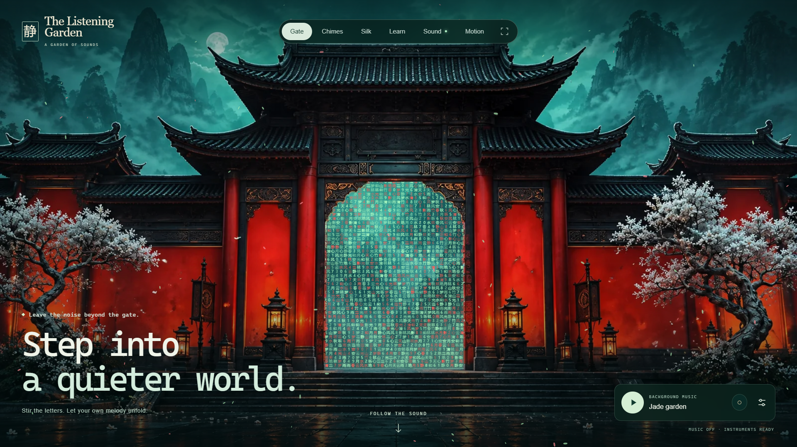
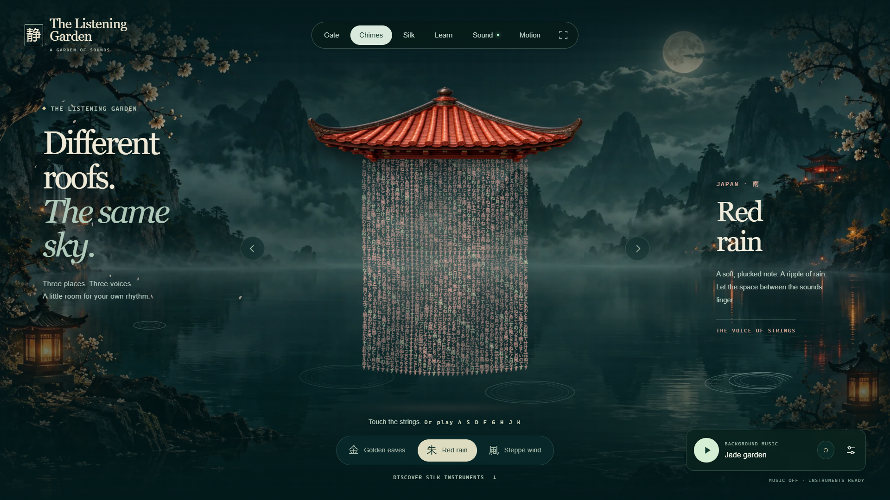
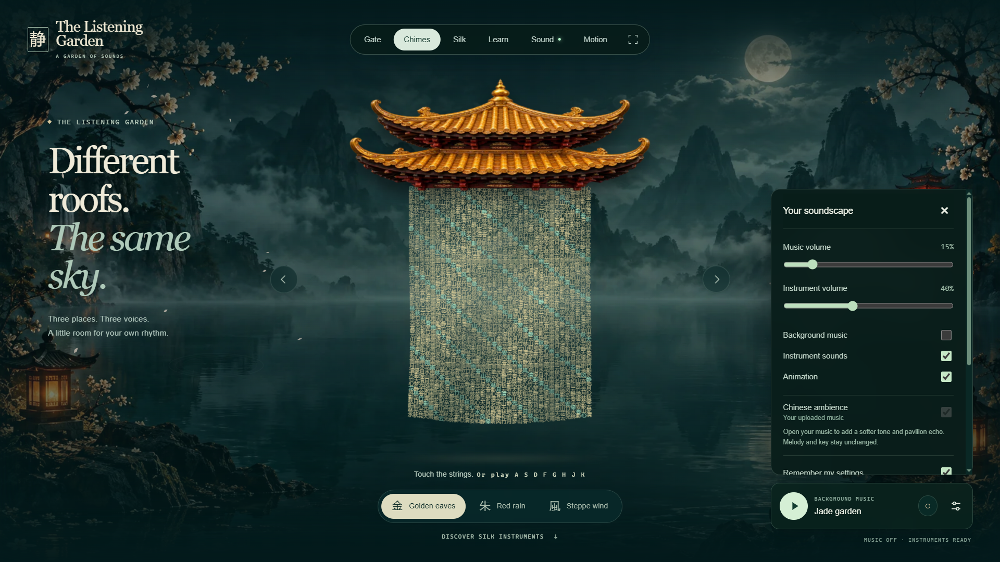
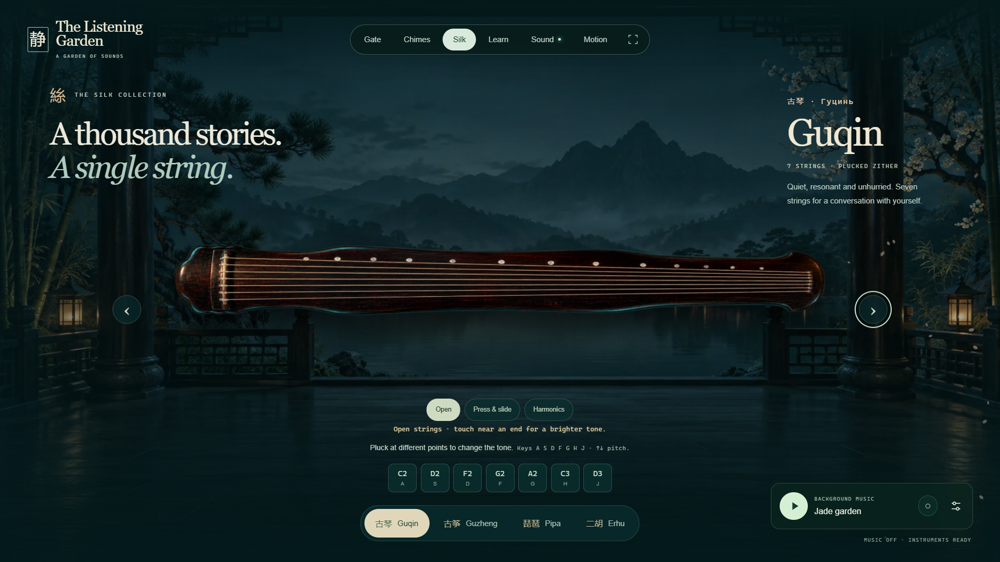
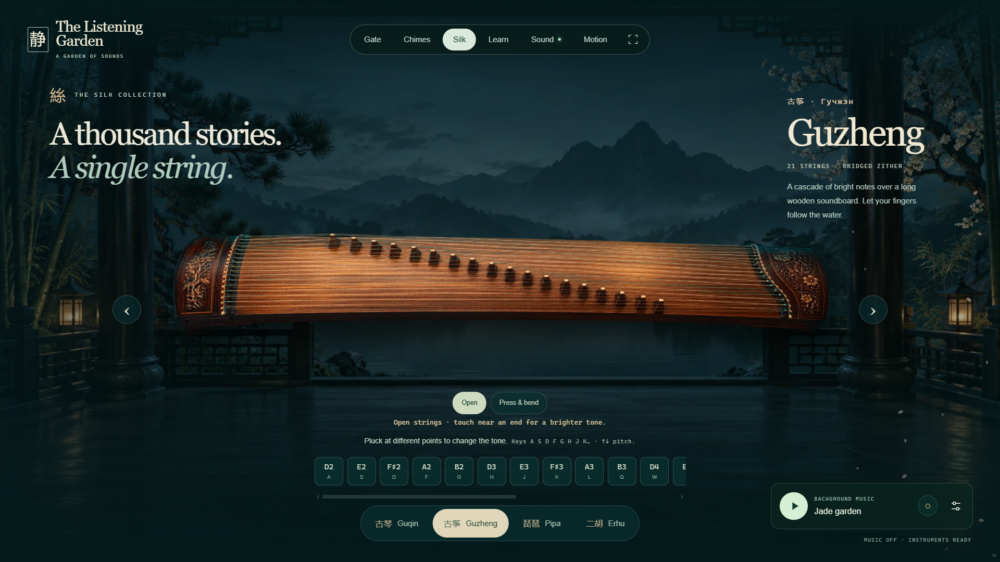
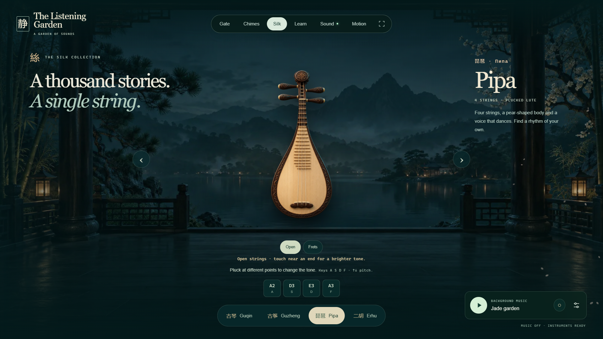
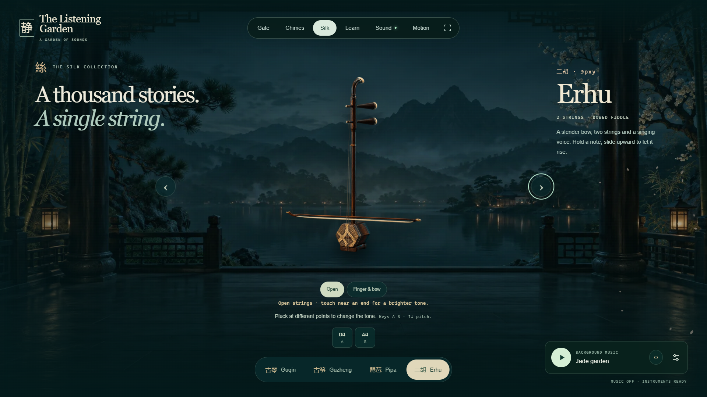
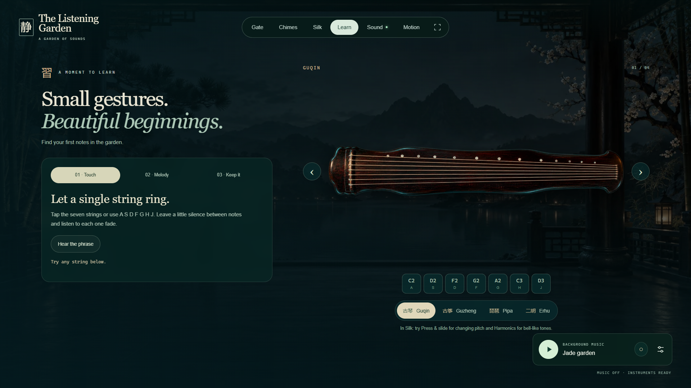

<p align="center">
  
</p>

<h1 align="center">The Listening Garden</h1>

<p align="center"><em>A quiet place to play, listen, and leave a little melody.</em></p>

<p align="center">Chinese-inspired musical worlds · Interactive instruments · Made for the browser</p>

<p align="center">
  <a href="#watch-the-demo">Video</a> ·
  <a href="#explore-the-garden">Explore</a> ·
  <a href="#screenshots">Screenshots</a> ·
  <a href="#play-your-first-notes">How to play</a> ·
  <a href="#run-locally">Run locally</a> ·
  <a href="PUBLISHING.md">Publish to GitHub Pages</a> ·
  <a href="LICENSE">MIT License</a>
</p>



## A garden that responds to you

Brush a curtain of letters. Pluck a string. Let a note linger over the water.

**The Listening Garden** is an interactive musical website inspired by Chinese gardens and instruments. It brings together atmospheric artwork, animated scenes, browser-generated sound, and short guided exercises. Play in silence, add the built-in **Jade garden** backing track, or bring your own music.

Built with **HTML, CSS, vanilla JavaScript, Canvas, SVG, and the Web Audio API**. No framework, package installation, or build step is required.

## Watch the demo

[](https://www.youtube.com/watch?v=2gaREXNzofA)

[▶ Watch Listening Garden 🌿 on YouTube](https://www.youtube.com/watch?v=2gaREXNzofA). The image above is a full-resolution screenshot of the Red rain scene; select it to open the video.

## Explore the garden

| World | What you can do |
| --- | --- |
| **Gate** | Stir the glowing letter curtain inside a jade courtyard and play pentatonic chimes. |
| **Chimes** | Move between Golden eaves, Red rain, and Steppe wind, each with its own tone and note palette. |
| **Silk** | Explore Guqin, Guzheng, Pipa, and Erhu through plucking, pressing, sliding, and bowing gestures. |
| **Learn** | Choose an instrument, hear a short phrase, follow the highlighted notes, and record your own interpretation. |

## Screenshots

The Gate scene above is the cover. Explore the chimes, instruments, lesson, and sound controls below. All images remain the original 1920 × 1080 PNGs.

| Chimes · Red rain | Your soundscape |
| --- | --- |
|  |  |

| Silk · Guqin | Silk · Guzheng |
| --- | --- |
|  |  |

| Silk · Pipa | Silk · Erhu |
| --- | --- |
|  |  |

### Learn · Guqin



## Small details, room to play

- **Four playable string instruments** with separate note layouts and synthesized timbres.
- **Independent music and instrument volume**, including the option to play without backing music.
- **Local music playback** with an optional Garden effect, Original/Garden comparison, and effect blend.
- **Recording and download** with an optional backing track, preview, and editable take name.
- **Opt-in saved settings** for sound, motion, and instrument choices.
- **Desktop and phone layouts**, with touch controls and compact playback tools.
- **Motion controls**, drifting petals, and interactive water ripples.

### The silk collection

| Instrument | Strings | Explore in Silk |
| --- | ---: | --- |
| **Guqin · 古琴** | 7 | Open notes, press and slide, harmonics |
| **Guzheng · 古筝** | 21 | Open notes and bends with a second touch |
| **Pipa · 琵琶** | 4 | Plucking and different fret positions |
| **Erhu · 二胡** | 2 | Sustained bowing and sliding pitch |

The instruments are expressive digital interpretations. Their sound is synthesized in the browser, rather than sampled from physical instruments. Learn introduces open-string playing and original eight-note exercises; it is not a complete traditional performance course.

## Play your first notes

1. Open **Gate** and move your pointer or finger across the letter curtain.
2. Visit **Chimes** or **Silk** and choose an instrument with the arrows or selector.
3. Tap strings or note buttons. On desktop, the displayed letter keys also play notes; in Silk, **↑ / ↓** adjust keyboard pitch where applicable.
4. In **Learn**, choose **Touch**, **Melody**, or **Keep it**. Use **Hear the phrase** to listen, then follow the glowing notes at your own pace.
5. Open the circular recording control beside the player's settings. Start a take, play, stop, preview, and choose **Download melody**.

Sound starts after a user interaction. If the garden is silent, check the Sound toggle and the separate instrument volume in settings.

### Bring your own music

Open sound settings → **Open your music**. Your file stays in the browser.

The optional **Garden** effect softens the tone, adds echoes, and makes room for the instruments. It does **not** rewrite the melody, change its key, or convert a recording into traditional Chinese music.

### Keep a little melody

Recording captures the website's audio; it does not use a microphone. Takes are limited to five minutes, with an additional size guard. The app attempts to export WAV and falls back to the browser's recording format when needed.

Download a take before leaving or reloading the page. Recordings and selected music files are not saved across sessions. **Remember my settings** saves preferences in this browser's local storage only.

## Run locally

From the project folder, with Python installed:

```sh
python -m http.server 8765 --bind 127.0.0.1
```

Open [localhost:8765](http://127.0.0.1:8765/). No dependencies need to be installed. Use a local server rather than opening `index.html` directly.

## Publish

This repository is a ready-to-serve static site. Keep `index.html` at the repository root, with the stylesheets, scripts, and `assets/` beside it.

For GitHub Pages, select **Deploy from a branch → main → / (root)** in **Settings → Pages**. See the [step-by-step publishing guide in Russian](PUBLISHING.md) and [GitHub's publishing-source documentation](https://docs.github.com/en/pages/getting-started-with-github-pages/configuring-a-publishing-source-for-your-github-pages-site).

Asset paths are relative, so the site can run at a repository URL such as `https://YOUR-USERNAME.github.io/listening-garden/`. Navigation uses URL fragments; no router rewrites are needed.

## Inside the project

```text
listening-garden/
├── index.html             # Four scenes and shared controls
├── assets/                # Garden artwork, instruments, and logos
├── app.js                 # Gate interaction and shared application controls
├── audio.js               # Synthesis, music playback, and effects
├── gallery.js             # Chime instruments and letter animation
├── garden-effects.js      # Petals and water ripples
├── silk.js                # String instrument interaction
├── string-touch.js        # Position-based playing techniques
├── silk-flowers.js        # Silk scene petals
├── learn.js               # Instrument lessons and guided phrases
├── recorder.js            # Audio capture, preview, and export
├── preferences.js         # Optional local preference storage
├── viewport.js            # Scene alignment and navigation
├── mobile.js              # Space reserved for the mobile player
├── *.css                  # Scene styling and responsive layouts
├── .nojekyll              # Static files without Jekyll processing
├── LICENSE
└── PUBLISHING.md
```

## Browser notes

Use a modern browser with Web Audio support. Recording additionally requires MediaRecorder support; format support can vary. Serve the published site over HTTPS.

The app has no account system, backend, analytics, or external runtime libraries. Music files and recorded audio are processed locally. Hosting-provider request logs are separate from the application.

Responsive layouts have been inspected in a desktop browser at phone-sized viewports. A physical-device Safari verification is still useful before promoting a release.

## Artwork & license

Garden scenes and instrument illustrations were generated for this project. The seal uses **静**, a character associated with quietness and stillness. The visual and musical presentation is a creative interpretation.

Released under the [MIT License](LICENSE). The license covers the project code, documentation, and included project-created assets to the extent that copyright applies. User-selected music files are not part of this repository or its license.

---

<p align="center"><em>Leave the noise beyond the gate.</em></p>
